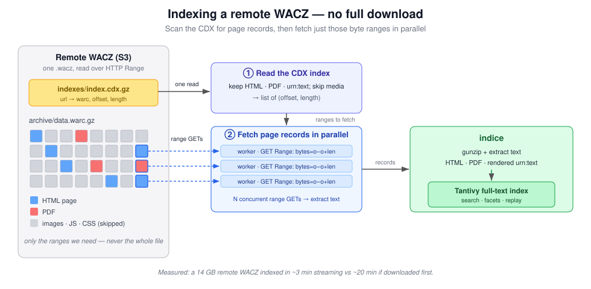

**TL;DR [indice](https://indice.page) is a new open source tool for searching web archives. [Install](https://indice.page/docs/install/) it locally or give the [demo](https://app.indice.page) a try. [Email me](mailto:ehs@pobox.com) if you want to give the curator privileges a try.**

---

Not too long ago I wrote about [reading rooms for the archived
web](https://inkdroid.org/2026/06/03/jan6-doj-archive/), or web sites that
provide contextualized access to archived web content. The basic idea is that
an aspirational reading room like this provides index, browse, search, and
descriptive layers that archival records need in order to be found and used by
researchers.

Over the past six months, with a lot of help from agentic-coding
tools (mostly Claude), I've been building a tool called
[indice](https://indice.page) to help make reading rooms like this. Since it's
[World Digital Preservation
Day](https://www.dpconline.org/events/world-digital-preservation-day) I thought
I'd share some of its design goals, and where you can take a look at it, if you
are interested.

This was my first real experiment in using "AI" for software development (more
on that in another post I think). I know some people will instinctively write
off *indice* immediately as "slop" and, let me clear, I respect that position.
But this post isn't about that. If you've dabbled with agentic coding tools at
all you will know that what matters most is the design thought that you put
into them. So what were these design ideas?

I guess the obvious first design principle is that users should be able to,
ahem, search the web archives. Given their odd shape, and size, search
has remained elusive for web archives. Internet Archive make [some
pockets](https://web.archive.org/collection-search) of their collections
searchable, and (I believe) have good reasons for not making more of it
searchable. There are tools like
[SolrWayback](https://github.com/netarchivesuite/solrwayback) for indexing and
searching large collections of WARC files, but not everyone can set up software
like this, and not everyone is working at this scale.

I wanted *indice* to run easily on my laptop, but also allow it to be used on
a server in a more institutional setting. I wanted a single program (or
*executable*) with *embedded* fulltext search capabilities, that I could run in
both settings, and not an "infrastructure" where a web server, a separate
indexing service cluster (e.g. Solr) needed to be managed.

You can [install](https://indice.page/docs/install/) *indice* today (which
should get easier in the future). I'm also currently running [a
demo](https://app.indice.page) on the smallest virtual machine (2 CPUs, 4GB of
RAM) I could find at [Hetzner]. *If you would like to give the curator features
a try [shoot me an email](mailto:ehs@pobox.com) and I can give you curator
privileges.*

I wanted *indice* to use Webrecorder's [ReplayWebPage](https://replayweb.page)
[web component](https://developer.mozilla.org/en-US/docs/Web/API/Web_components)
which (IMHO) is the state-of-the-art when it comes to replaying the archived
web. Its approach of using service workers in the web browser to intercept
requests to the live web, so that it can return archived content from
a [WACZ](https://specs.webrecorder.net/wacz/1.1.1/) file, that can be hosted
anywhere on the web is ingenious, and continues to be revolutionary for web
archives. It lets web archives become a [media type for the
web](https://inkdroid.org/2021/11/24/wacz/).

[Emily Maemura](https://ischool.illinois.edu/people/emily-maemura) et. al have
persuasively argued that the lack of provenance in web archives makes it
difficult for researchers to use them:

> Both social and technical factors influence what is captured and preserved for the future, but for any given collection these are often opaque; at best, decisions and constraints are documented inconsistently. Few have addressed the specific ways in which researchers could understand the technical processes, systems, and computing environments used—as well as the human judgments and decisions that shape the archive. This remains a key barrier to the use of web archives for research purposes. [@Maemura:2018, p. 1224]

The descriptive metadata in a WACZ file can contain information about who
created the archive, when and with what software. It includes an index of the
web resources that it contains, and the "seeds" or starting points that that
were used to start the crawler. And critically, it bundles the one or more
[WARC](https://en.wikipedia.org/wiki/WARC_(file_format)) files that contain the
archived web content, that were created as *part of the same crawl*. Finally the
WACZ has a manifest that helps you ensure the completeness and validity of the
archived content.

I wanted *indice* to foreground this provenance, and to use WACZ as core
building block of the archive. I like to think of WACZ files as the [Hollinger
boxes](https://en.wikipedia.org/wiki/Hollinger_box) that line shelves in brick
and mortar archives. You can only load WACZ files into *indice*. Each WACZ is
a *crawl* and *collections of crawls* are the core organizing principle of the
application. Being able to see technical metadata and for archivists to
describe the contents is encouraged and facilitated.

It should be said *indice* doesn't create the WACZ files itself. You need to
use [other tools](https://indice.page/docs/guides/wacz/#making-a-wacz) for
that. However I did want to make it possible for users of Browsertrix and
Archive-It to be able to import their web archives. So *indice* does have
connectors to those services which administrators can use to pull in and index
the archived content. In the case of Archive-It, which doesn't make WACZs
available, *indice* will assemble one for you.

You can also import WACZs that are held in cloud storage (S3, etc), or really
anywhere on the web (if the server allows HTTP range requests). The content can
stay, and replay from web storage, while the index lives locally with *indice*.
This is quite nice during indexing because the CDX index can be used to only
pull back indexable content, rather than needing to download the whole
(possibly large) file.

I wanted curators (the people importing content to *indice*) to be able to
extract and describe the crawls they are adding. Some of this happens
automatically during indexing and some it is done manually during collection description:

* *Pages*: From each archived page it takes what the page says about itself:
  the HTML title, the meta description, keywords and author, the h1/h2
  headings, the language (declared, or detected from the text when not
  declared), the media type, the HTTP status and the Last-Modified year.
  Combined with the URL, site and capture date, these let you search, filter
  and facet (by site, year, type and language) without reopening the archive.
* *Crawls*: For each crawl it records how the capture was made, taken from the
  WACZ datapackage.json and the WARC warcinfo records: the software, operator,
  user agent, robots policy, the capture date range, a tally of HTTP statuses,
  and the Browsertrix QA rating when there is one.
* *Collections*: Each collection has a finding aid built around
  [DACS/EAD](https://www2.archivists.org/groups/technical-subcommittee-on-describing-archives-a-content-standard-dacs/describing-archives-a-content-standard-dacs-second-).Its
  fields are creator, dates, rights and subjects, plus a narrative covering
  scope and content, custodial history and appraisal.

One experimental, and I must stress, *completely optional* feature is the
ability to auto-generate collection level descriptions using a configured Large
Language Model (LLM). The *indice* interface lets the user know what model is
being used, as well as what content and prompt is going to be sent, *prior* to
it being sent. I've configured the [demo](https://app.indice.page) to use my
[Inference Cooperative](https://inference.coop) account to access the [Deepseek
v4.1-flash](https://www.deepseek.com/en/news/deepseek-v4-1-flash/) open weight
model, at [GreenPT](https://greenpt.com/) who provide location based carbon and
energy reporting about your usage. The goal here isn't to replace the curator
and their insights, but to assist them by giving them a starting point to work
from, and to describe things at a high level which otherwise might not get
described.

And lastly, but I think the most cool feature, is the ability to *annotate*.
When viewing content in the web archive curators can choose to add an
annotation at the page or content level. These annotations are then visible to
anyone else who looks at the content, and are indexed. They are stored using
the [Web Annotation](https://www.w3.org/TR/annotation-model/) W3C standard as
JSON-L files alongside the Markdown files that make up the rest of the
descriptive metadata. Yes, the DACS informed archival description isn't stuffed
away in a database, it's a plain Markdown file on the filesystem where *indice*
is running. You can back these up along with the WACZ data, and you could
reconstitute the *indice* server, or build some better system to use them.

*indice* is meant to be a *preservation relay*, or a temporary software
container for web archives, where the data is allowed and encouraged to outlive
the software [@Janee:2009]. Because, as the saying goes, ["data ages like wine,
and applications like
fish"](https://redmonk.com/jgovernor/why-applications-are-like-fish-and-data-is-like-wine/).

There's more I'd like to write about, like *indice*'s approach to identity
management (hint, it doesn't and lets you integrate with an upstream identity
provider); how it needs to take care when parsing PDFs from the world wide web;
how it protects against malicious replayed JavaScript from interfering with
*indice* itself, and [what's with the name](https://indice.page/#why). But I guess that
will need to wait. I've taken enough your time, and there are other World
Digital Preservation stories for you to read today! If you give *indice* a try,
either the demo, or locally, I'd love [to hear](mailto:ehs@pobox.com) from you.

### References
