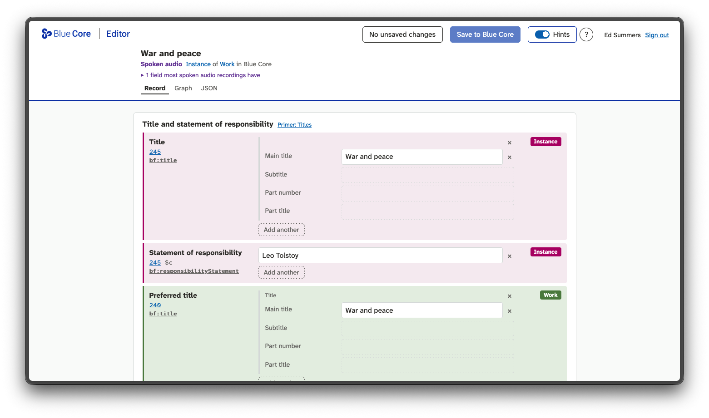
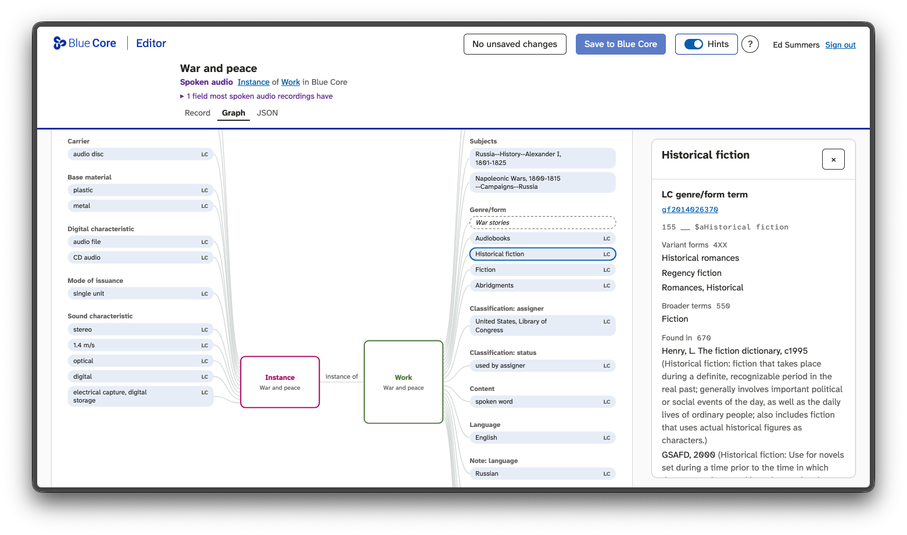
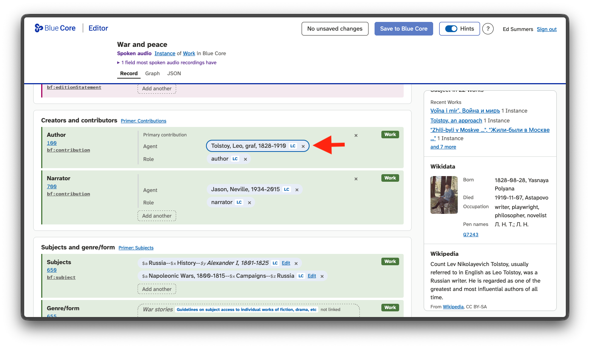
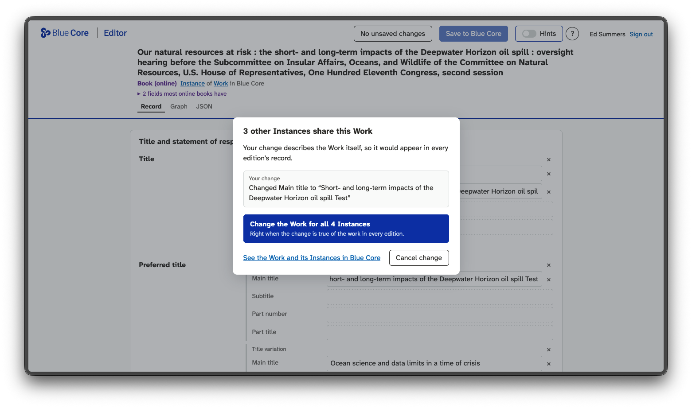

At work I've spent a significant amount of time over the past year working with the [Blue Core] team re-engineering some of the [Sinopia] tooling. Part of that has been ensuring that the RDF that is being stored in our PostgreSQL database as JSON uses the (brand new) [bibframe-json] JSON-LD context and schema.

This may seem like a small thing, to store data consistently in a database. But unfortunately when you are talking about RDF data it's not always a given. RDF supports many serialization formats, and even within a format, like JSON-LD, there are multiple ways to say the same thing.

Some people think this is a strength of RDF in that it is a data model, rather than a particular data format. They're not wrong. But when you are building tools to use the data and aren't using a [triplestore] it is *extremely* helpful to know the structure of the JSON when you want to parse it as JSON and use it, instead of needing to parse it as RDF and using the resulting graph. I'm really hopeful that the Blue Core project, in its use of [bibframe-json], can provide a JSON friendly format for BIBFRAME data. It's still early days as it's just at v0.1, and there are already some things that could be improved.

The [Blue Core API] follows the [robustness principle] in that its endpoints let you send BIBFRAME RDF in multiple serialization formats. However the received RDF data is [framed] and stored in the database with a specific JSON-LD context. This means users of the API can expect the BIBFRAME JSON-LD to look a particular way. This is super important for interoperability because it means clients using the data can just treat it like any other JSON that they would get from any other Web API, and not have to process it as RDF (unless they really want to).

This isn't a new idea. It's called [Linked Open Usable Data] (LOUD), which Rob Sanderson distilled from the [IIIF] projects successful use of Linked Data.

Having a consistent shape of JSON-LD opens some doors for experimenting with different BIBFRAME editors that don't need to be RDF aware. They simply load and edit the JSON, and can use the JSON Schema as a guide for what is possible to say. One such experiment is the [bluecore-editor]. It was designed and coded relatively quickly (in a couple days) with Claude Code. 

When working with Claude to design [bluecore-editor](https://github.com/edsu/bluecore-editor) I started with (and evolved) a few design principles. I thought I would jot them down here, in case anyone else is interested in the experiment, and maybe creating their own.

## Records not Resources

Catalogers think in terms of bibliographic and authority *records* when doing cataloging. They can learn how to think in terms of BIBFRAME Works, Instances, and Hubs. But when they have a book in front of them, they are creating a single description, that happens to consist of several types of resources. The editor should *compose* these resources into a single editing surface and not require them to edit resources separately, while holding the big picture in their head. 

So the editor is organized with a hopefully familiar [ISBD] layout, and the underlying resources can be revealed by clicking on a "Hints" toggle, which displays what properties are associated with Works, and which with Instances, as well as what the related BIBFRAME vocabulary term is. It even displays related MARC information for catalogers who are familiar with those.

If you want you can see the resources visualized as a graph, where you click on each resource to see what it is. Which leads to the next point.

## But still, Resources!

As that graph  makes clear, when catalogers describe a book (or some other type of item) they use many resources, including authority records for people, organizations, subjects, and controlled vocabulary terms for languages, countries, relators, etc. These resources are all referenced using a URI (this is Linked Data after all). But catalogers need to see more than just the URI. They need to see a description of the resource to decide whether to use it or not.  

The "context pane" in bluecore-editor lets catalogers see information about these resources in the context of their work, as they need it, and doesn't require an extra click and context shift to another browser window to do that. 
For example when editing this audiobook version of War and Peace you click on Tolstoy's name, and see information from the LC Name Authority File, Wikidata and Wikipedia (if those links exist):

One of the challenges here when editing one part of the description could impact other descriptions. The canonical example this is in Authority Control work when someone changes the subject heading or name authority which ideally would update all uses of the record, but more often than not means all those descriptions need to be updated. But knowing when a change could impact other descriptions is important, especially in BIBFRAME where editing properties related to a Work could impact its other Instances. That's why the bibframe-editor notifies you, and asks for your approval, when one of your edits could impact other descriptions.

I think this is why [Linked Data] is (still) a powerful concept for cataloging. RDF is really just a means to an end. The end-goal is for catalogers to be able to build up bibliographic descriptions by reusing, updating and creating bibliographic resources for people, topics, etc.

## Suggestions not Templates

[Templates] (aka [Profiles]) in Sinopia have proven to be difficult to create, update and maintain over time. Templates do multiple things. They decide what assertions a description can contain, what the editing interface needs to show, and how it should behave. Profiles need to do these things as the resource descriptions and other profiles change.

We have been trying solve this by *versioning* templates and attaching them to the resources (instances, works, and hubs) that used them. This means that the minute that a template is updated, all the resources that used the template are instantly stale, and need some attention to bring them up to date. Templates can have sub-template references, which compounds these problems. When a child template changes that change then ripples up to a change its parent.

*bluecore-editor* takes a different approach by analyzing existing BIBFRAME records from LC to build up a statistical profile of what vocabulary terms have been used with what resource types. It then uses this information as a set of *Suggestions*, by type (book, map, etc), when the cataloger is working. The editor also includes *overrides* which allow you to suggest something that's not common, or remove something that is not desired. But suggestions are ultimately driven by cataloging practice rather than top-down rules.

This is just an experiment at the moment, and not meant to replace Sinopia Editor. But I'm hopeful that the ability to use consistently shaped JSON from the Blue Core API, without needing to understand RDF will unlock other use cases, and bluecore-editor is just one example. I'm also hopeful other projects that want to use BIBFRAME, and want to use JSON, will find their lives made a bit easier. If you have ideas please get in touch in the [issue tracker].

[bibframe-json]: https://bibframe-json.org
[Blue Core]: https://bluecore.info
[Sinopia]: https://sinopia.io/
[Blue Core API]: https://github.com/blue-core-lod/bluecore_api
[robustness principle]: https://en.wikipedia.org/wiki/Robustness_principle
[bluecore-editor]: https://github.com/blue-core-lod/bluecore-editor
[framed]: https://www.w3.org/TR/json-ld11-framing/
[ISBD]: https://en.wikipedia.org/wiki/International_Standard_Bibliographic_Description
[Profiles]: https://www.loc.gov/bibframe/docs/bibframe-profiles.html 
[Templates]: https://github.com/LD4P/sinopia/wiki/Setting-Up-Templates
[issue tracker]: https://github.com/blue-core-lod/bibframe-json/issues/
[Linked Data]: https://en.wikipedia.org/wiki/Linked_data
[triplestore]: https://en.wikipedia.org/wiki/Triplestore
[Linked Open Usable Data]: https://linked.art/loud/
[IIIF]: https://iiif.io
